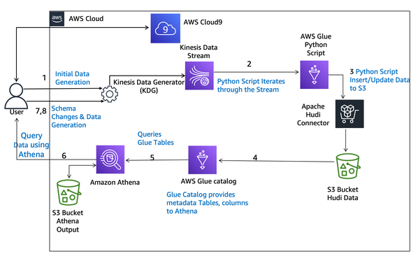

# Real-Time Data Streaming Pipeline with Schema Evolution on AWS

## Project Overview

This project demonstrates a real-time data streaming pipeline on AWS that processes simulated Internet of Things (IoT) sensor data and stores it in an Amazon S3 data lake.

The pipeline uses Amazon Kinesis Data Streams to ingest sensor events, AWS Glue to process the incoming data, and Apache Hudi to support incremental inserts and updates. Amazon Athena is used to query the resulting dataset using SQL.

A key feature of this project is **schema evolution**: the incoming data structure changes over time, and the pipeline demonstrates how new fields and missing fields can be handled without manually rewriting the processing logic for each schema change.

This project was completed as a hands-on AWS data engineering lab focused on updating dynamic data in place.

## Objectives

- Ingest simulated IoT sensor data using Amazon Kinesis Data Streams.
- Process streaming data using an AWS Glue streaming job.
- Store and update records in an Amazon S3 data lake using Apache Hudi.
- Handle schema changes as new fields are introduced or omitted.
- Query streaming data and Hudi metadata using Amazon Athena.
- Deploy the AWS Glue job using AWS CloudFormation.

## Architecture

The pipeline follows this data flow:

1. **Data generation:** The Kinesis Data Generator simulates sensor events.
2. **Data ingestion:** Amazon Kinesis Data Streams receives the incoming records.
3. **Stream processing:** An AWS Glue streaming job reads and processes the records.
4. **Incremental data updates:** Apache Hudi manages inserts and updates in the S3 data lake.
5. **Metadata management:** The AWS Glue Data Catalog provides table metadata.
6. **Data analytics:** Amazon Athena queries the stored data using SQL.
7. **Schema evolution:** New fields are introduced and later omitted to demonstrate how the pipeline handles changing schemas.

<!-- Add your architecture diagram below if you have one. -->



## Technologies Used

| Technology | Purpose |
|---|---|
| Amazon Kinesis Data Streams | Ingests streaming IoT sensor events |
| AWS Glue | Processes incoming streaming records |
| Apache Hudi | Supports incremental inserts and updates |
| Amazon S3 | Stores the data lake files |
| AWS Glue Data Catalog | Maintains table metadata |
| Amazon Athena | Queries the data lake using SQL |
| AWS CloudFormation | Deploys the Glue job infrastructure |
| Python | Implements the streaming data-processing logic |
| SQL | Queries sensor data and Hudi metadata |
| Parquet | Columnar storage format for analytical data |

## Implementation

### 1. AWS Resource Configuration

The lab environment provides the AWS resources required for the pipeline, including the Kinesis stream, S3 bucket, IAM role, and Glue Data Catalog resources.

AWS CloudFormation is used to deploy the additional Glue job infrastructure.

### 2. Streaming Data Ingestion

The Kinesis Data Generator simulates IoT devices sending sensor records to an Amazon Kinesis Data Stream.

The records contain fields such as:

- `name`
- `date`
- `year`
- `month`
- `day`
- `column_to_update_integer`
- `column_to_update_string`

The generator continuously sends records representing four simulated sensors.

### 3. Stream Processing with AWS Glue

An AWS Glue streaming job reads records from Kinesis and processes them using Python.

The job prepares incoming records for storage in the data lake and uses Apache Hudi to manage changes to existing data.

### 4. Incremental Updates with Apache Hudi

Apache Hudi enables records to be inserted and updated in the data lake without requiring the entire dataset to be rewritten for each update.

The pipeline uses Hudi record keys and commit metadata to help track record changes.

The resulting dataset is stored in Amazon S3 in a format suitable for analytical queries.

### 5. Querying Data with Amazon Athena

Amazon Athena queries the Hudi dataset through the AWS Glue Data Catalog.

The initial queries inspect sensor records and Hudi metadata to examine the data being written and updated.

Example query to inspect the table:

```sql
SELECT *
FROM "hudi_demo_db"."hudi_demo_table"
LIMIT 10;
```

Example query to inspect Hudi metadata:

```sql
SELECT
    _hoodie_commit_seqno,
    _hoodie_record_key,
    column_to_update_string
FROM "hudi_demo_table";
```

These queries help examine the stored records and the metadata associated with Hudi commits.

### 6. Handling Schema Evolution

The pipeline demonstrates how incoming records can change their schema while the streaming job continues processing data.

#### Scenario 1: Initial Schema

The initial records contain seven fields, including sensor identifiers, date information, and fields used to demonstrate record updates.

#### Scenario 2: Adding a New Field

The incoming schema is changed to include an additional field named `new_column`.

The pipeline demonstrates how this new field can be incorporated into the dataset and queried through Athena without manually modifying the Glue job for that schema change.

Example query:

```sql
SELECT
    _hoodie_commit_seqno,
    _hoodie_record_key,
    column_to_update_string,
    new_column
FROM "hudi_demo_table";
```

#### Scenario 3: Reverting to the Original Schema

The incoming data is changed back to the original schema, which no longer includes `new_column`.

The pipeline demonstrates that the field can remain part of the existing table schema while records that do not provide a value for it contain `NULL`.

This illustrates an important consideration when working with evolving data structures: existing data, incoming records, and table metadata may represent different versions of a schema.

## Repository Structure

```text
aws-realtime-streaming-pipeline/
├── README.md
├── scripts/
│   └── glue_job_script.py
├── infrastructure/
│   └── glue_job.template
├── sql/
│   └── streaming_analysis.sql
├── architecture/
│   └── architecture-diagram.png
└── screenshots/
    ├── 01-cloudformation-lab-resources.png
    ├── 02-glue-job-deployment.png
    ├── 03-glue-streaming-job-running.png
    ├── 04-kinesis-data-generation.png
    ├── 05-hudi-table-and-initial-data.png
    ├── 06-hudi-record-updates.png
    ├── 07-schema-evolution-new-column.png
    ├── 08-schema-evolution-updated-records.png
    └── 09-schema-reversion-null-column.png
```

*The repository structure lists the intended files. Include only files that are actually present.*

## Screenshots and Evidence

The `screenshots/` directory documents the main stages of the project:

- **CloudFormation resources:** Lab infrastructure and resource configuration.
- **Glue job deployment:** Successful deployment of the streaming job.
- **Streaming job execution:** Glue job running in AWS.
- **Kinesis data generation:** Simulated sensor data being sent to the stream.
- **Initial Hudi data:** Sensor records queried using Athena.
- **Record updates:** Evidence of changing records and Hudi metadata.
- **Schema evolution:** Results after introducing `new_column`.
- **Schema reversion:** Results after returning to the original schema.

These screenshots provide evidence of the pipeline's configuration and demonstrated behavior.

## Key Learnings

Through this project, I explored:

- Building a streaming ingestion workflow with Amazon Kinesis Data Streams.
- Processing incoming data using AWS Glue.
- Using Apache Hudi to manage incremental data changes.
- Storing data in Amazon S3 for analytical workloads.
- Querying Hudi datasets and metadata using Amazon Athena.
- Understanding schema evolution in a streaming data pipeline.
- Deploying AWS resources with CloudFormation.
- Examining how missing fields are represented when incoming schemas change.

## Project Context

This project was completed as a hands-on AWS data engineering lab. The supplied lab script and infrastructure template were used as part of the exercise.

The project demonstrates a proof of concept for streaming ingestion, incremental data updates, and schema evolution. It is not intended to represent a production deployment.

## Author

**Umair Farooq**

- GitHub: [umair9211](https://github.com/umair9211)
- LinkedIn: [Umair Farooq](https://linkedin.com/in/umair-farooq-6ab9b2201)
